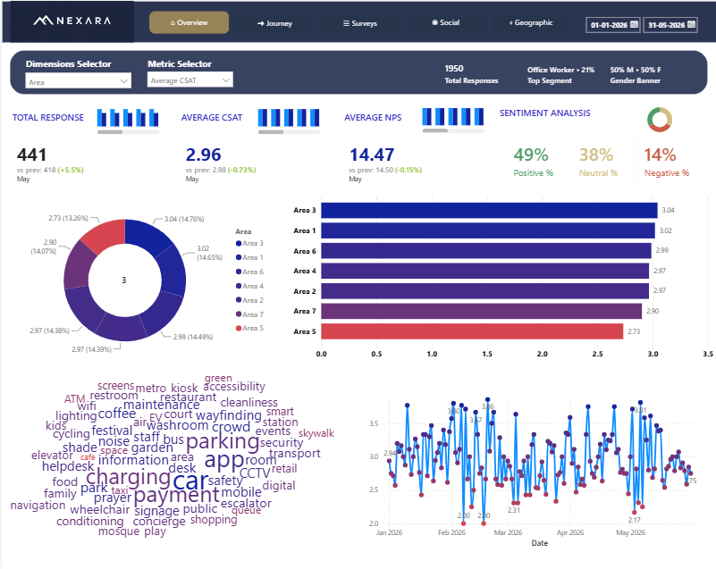
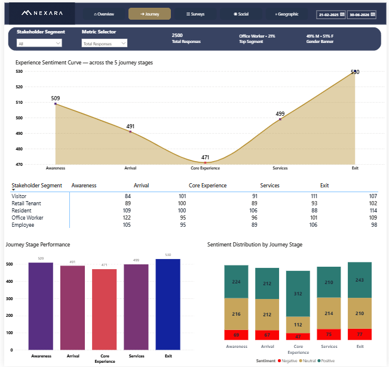
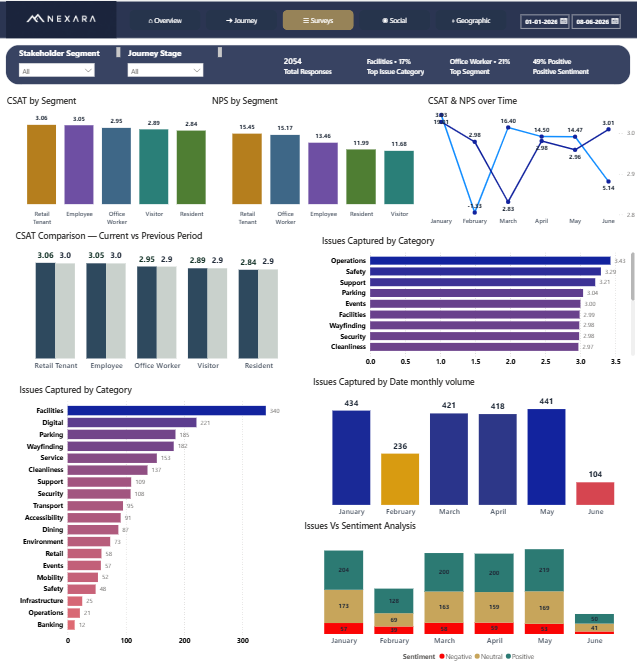
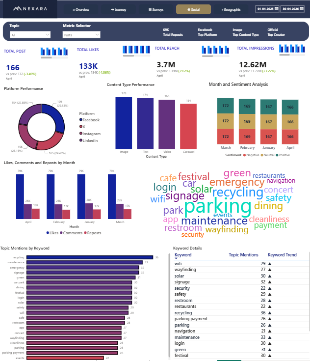
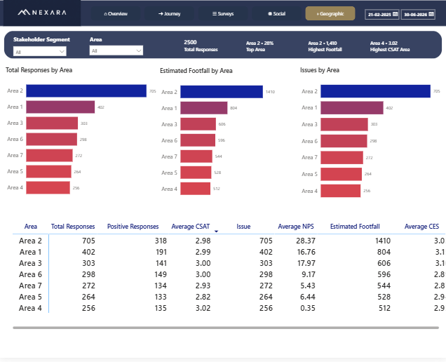

# Nexara — Stakeholder Experience & Sentiment Dashboard

An interactive analytics dashboard designed to explore stakeholder experience, customer satisfaction, sentiment, journey-stage performance, survey issues, social conversations, and geographic patterns.

The dashboard brings multiple views together so stakeholders can move from high-level KPIs to more detailed breakdowns by segment, journey stage, issue category, platform, keyword, and area.

## Dashboard Preview

### Overview
High-level view of total responses, average CSAT, average NPS, sentiment distribution, area-level comparisons, and response trends.



### Journey
Journey-stage analysis across Awareness, Arrival, Core Experience, Services, and Exit, including experience sentiment, stakeholder-segment comparisons, and sentiment distribution.



### Surveys
Survey response analysis with CSAT and NPS by stakeholder segment, period comparisons, issue categories, monthly issue volume, and sentiment analysis.



### Social
Social media performance and conversation analysis, including post and engagement metrics, platform/content-type performance, monthly sentiment, and keyword trends.



### Geographic
Area-level comparison of responses, estimated footfall, issues, CSAT, NPS, and CES.



## Dashboard Sections

| Section | What it covers |
|---|---|
| **Overview** | Summary KPIs, sentiment split, CSAT by area, and response trends |
| **Journey** | Experience curve and performance across five journey stages |
| **Surveys** | CSAT/NPS by segment, period comparison, issue categories, and monthly sentiment |
| **Social** | Social post metrics, platform performance, content types, sentiment, and keyword trends |
| **Geographic** | Area-level responses, estimated footfall, issues, and experience metrics |

## Key Capabilities

- KPI summaries for quick performance monitoring
- Filters for stakeholder segment, journey stage, metric, area, topic, and date range where applicable
- Comparisons across stakeholder segments, journey stages, areas, platforms, and time periods
- Sentiment breakdowns across negative, neutral, and positive responses
- Issue-category analysis to help identify recurring service pain points
- Keyword and topic analysis to surface frequently mentioned themes
- Multiple views designed to support both executive summaries and deeper investigation

## Questions This Dashboard Can Help Explore

- Which stakeholder segments report stronger or weaker satisfaction?
- At which journey stage does experience appear to improve or deteriorate?
- Which issue categories are mentioned most frequently?
- How does sentiment change over time?
- Which geographic areas have the highest response volumes, estimated footfall, or issue counts?
- What themes appear most frequently in social conversations?

## Repository Structure

```text
nexara-dashboard/
├── README.md
└── 
    ├── overview.png
    ├── journey.png
    ├── surveys.png
    ├── social.png
    └── geographic.png
```

## Tools & Implementation

**Dashboard tool:** Power BI *(update this if the dashboard was built in another tool)*

The dashboard uses interactive visualisations, KPI cards, trend charts, category comparisons, and detailed tables. Add the data source, modelling approach, refresh cadence, and exact technology stack here if you want this README to serve as a technical project document.

## Notes

- Screenshots are included for portfolio and documentation purposes.
- Figures shown in the screenshots reflect the displayed reporting periods and should not be interpreted as live data unless connected to a refreshed data source.
- Ensure that any data shared publicly is approved for disclosure and does not expose confidential or personally identifiable information.

## Future Improvements

- Add a data dictionary describing each KPI and its calculation
- Document data sources, relationships, and transformation logic
- Add a methodology note for sentiment classification and estimated footfall
- Include accessibility checks, chart descriptions, and a consistent colour legend
- Add a short walkthrough or demo link

---

*Built as a stakeholder experience and sentiment analytics dashboard.*
